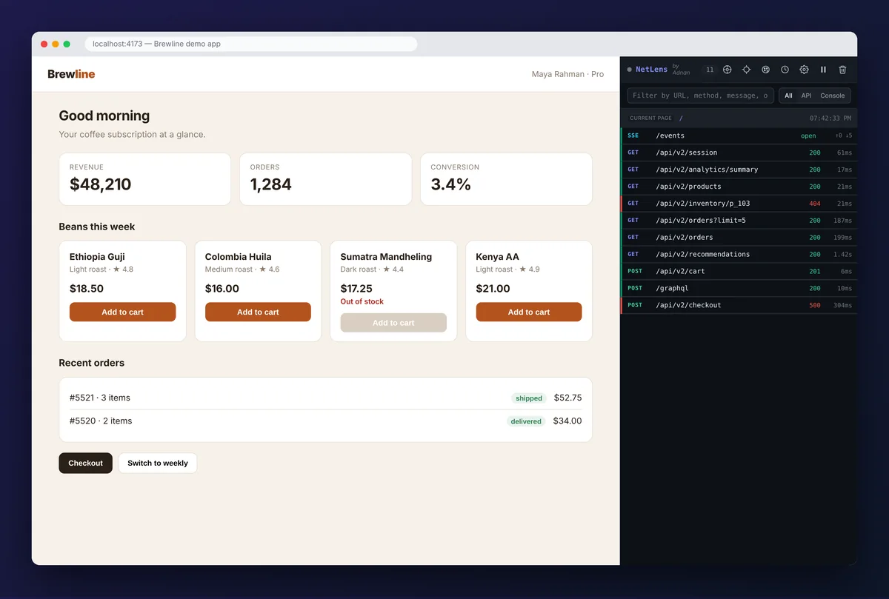
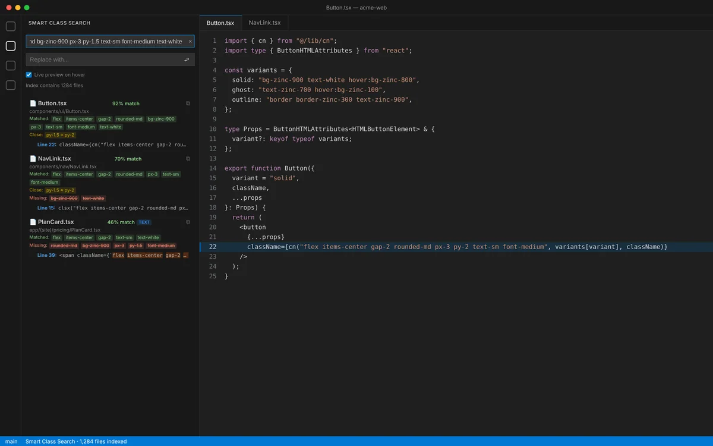
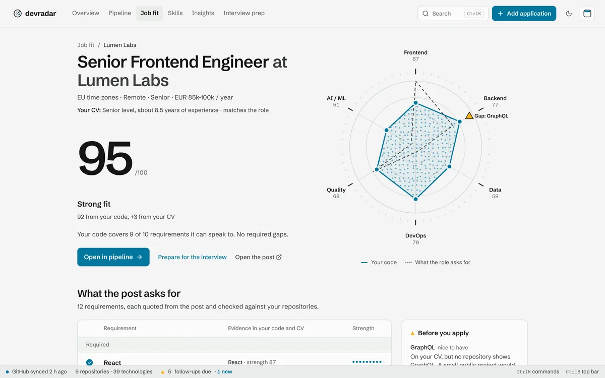
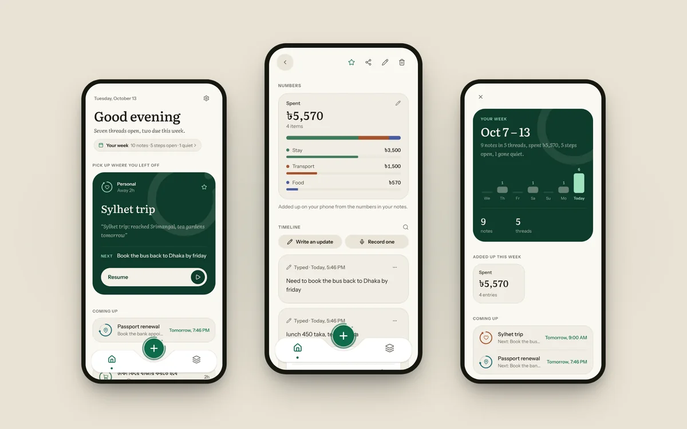
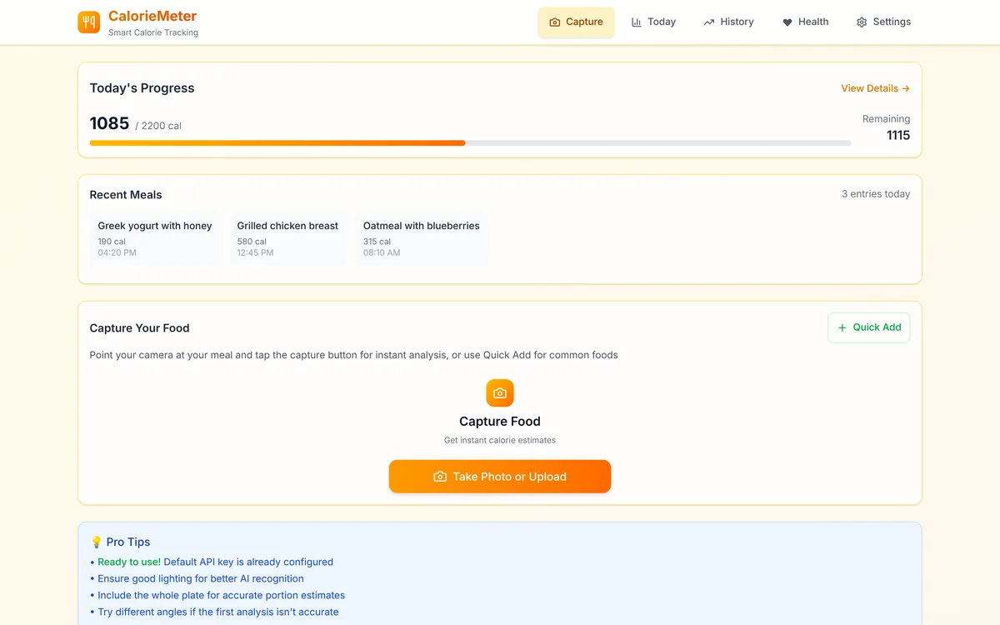
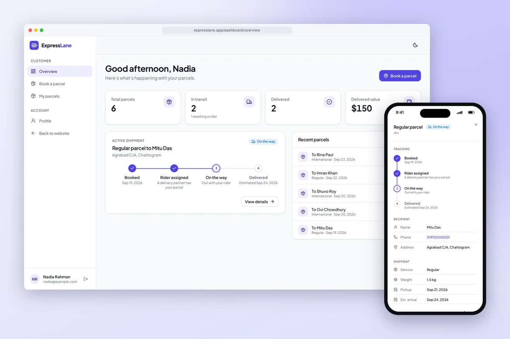

 
 
I build full-stack web apps — fast React interfaces, the Node backends behind them, and the payments, auth and booking flows in between. I care about apps that feel fast, not just benchmark fast, and code that someone else can read and run.
 
 

<!-- Add your portfolio once it's live:

-->

---

## ◆ Selected Work

#### [NetLens](https://github.com/Armstain/NetLens)

A page’s API calls — payloads, responses, headers — in a Chrome side panel, with no DevTools open. Calls fired during page load are caught anyway, and any request can be edited, replayed and diffed. Tokens are decoded in place, and you can click an element on the page to trace it to the API field behind it.

<code>JavaScript · Chrome extension · MCP</code>

**[Source](https://github.com/Armstain/NetLens)**

 

#### [Smart Class Search](https://marketplace.visualstudio.com/items?itemName=armstain.smart-class-lookup)

Paste a class list copied from DevTools and jump to the component that renders it — even through `cn()`, `clsx()`, template literals and conditionals. Over 4,000 downloads across the VS Code Marketplace and Open VSX; parsing runs in worker threads so the editor stays responsive.

<code>TypeScript · VS Code API · Babel · Worker threads</code>

**[VS Code Marketplace](https://marketplace.visualstudio.com/items?itemName=armstain.smart-class-lookup)** · **[Open VSX](https://open-vsx.org/extension/nazmul-hossain-adnan/smart-class-lookup)** · **[Source](https://github.com/Armstain/smart-class-lookup)**

 

#### [DevRadar](https://dev-radar-gold.vercel.app)

A job-search platform that combines organisation, analytics and AI interview preparation. Each job post gets a fit report: a score, how your code and CV match each requirement, a skills radar, and a way into interview prep.

<code>TypeScript · Next.js · Drizzle · Gemini</code>

**[Live app](https://dev-radar-gold.vercel.app)** · **[Source](https://github.com/Armstain/devRadar)**

 

#### [Mnemo](https://mnemo.nazmulhossainadnan.me/)

A memory app for interrupted lives: say a thought, and AI gives it a title, a summary and a next step, so you can pick the thread back up. Voice-first capture that handles Bangla, English, or both in one sentence. Currently in progress.

<code>React Native · Expo · Gemini</code>

**[Website](https://mnemo.nazmulhossainadnan.me/)** · **[Source](https://github.com/Armstain/Mnemo)**

 

### ▸ Also built

#### [CalorieMeter](https://calorietracker-puce.vercel.app)

Photograph a meal and get its calories and macros back. Fixing a wrong guess is one sentence — “that’s grilled, not fried”. A five-model Gemini fallback keeps it working through free-tier limits, and all data stays on the device.

<code>TypeScript · Next.js · TanStack Query</code>

**[Live app](https://calorietracker-puce.vercel.app)** · **[Source](https://github.com/Armstain/calorie-tracker)**

 

#### [ExpressLane](https://expreane-c2384.web.app)

Parcel delivery with live tracking, role-based accounts and an admin dashboard. Redesigned and rebuilt end to end: light and dark design system, server-enforced roles, a Postgres and Prisma migration, 22 automated tests in CI, and a bundle cut from 1.52 MB to 0.65 MB.

<code>React · Node.js · PostgreSQL · Prisma · Stripe</code>

**[Live app](https://expreane-c2384.web.app)** · **[Source](https://github.com/Armstain/Expresslane)**

 

---

## ◆ GitHub Activity

 
Public GitHub activity, refreshed daily.

---

## ◆ Toolkit

| Layer | Technologies |
|:---|:---|
| **Frontend** |     |
| **Styling** |     |
| **Backend** |    |
| **Database** |    |
| **Tooling** |      |

---

## ◆ Contributions

  <picture>
    <source media="(prefers-color-scheme: dark)" srcset="https://raw.githubusercontent.com/armstain/armstain/main/assets/contrib-dark.svg" />
    <source media="(prefers-color-scheme: light)" srcset="https://raw.githubusercontent.com/armstain/armstain/main/assets/contrib-light.svg" />
    
  </picture>

---

Want to work together? **[nazmulhossainadnan0@gmail.com](mailto:nazmulhossainadnan0@gmail.com)**

