 
 
I build full-stack web apps — fast React interfaces, the Node backends behind them, and the payments, auth and booking flows in between. I care about apps that feel fast, not just benchmark fast, and code that someone else can read and run.
 
 

<!-- Add your portfolio once it's live:

-->

---

## ◆ Selected Work

#### [UrbanDrive](https://cheery-bubblegum-eecb30.netlify.app/)

A car rental platform where users browse, book and manage rentals, with live availability, live chat support and an admin dashboard for approving listings. React and TypeScript on the front end, Node and Express with MongoDB behind it, and Firebase handling authentication.

     

**[Live app](https://cheery-bubblegum-eecb30.netlify.app/)** · **[Client](https://github.com/Armstain/UrbanDrive)** · **[Server](https://github.com/aayman01/UrbanDrive-Server)**

 

#### [ExpressLane](https://expreane-c2384.web.app/)

Parcel delivery, simplified: book a pickup in under a minute, follow every step of the journey, and pay once it arrives. Includes real-time tracking, user authentication and an admin dashboard. A React and Vite front end sits on an Express API with Prisma and PostgreSQL, Stripe handles payments, and CI runs on every push.

      

**[Live app](https://expreane-c2384.web.app/)** · **[Source](https://github.com/Armstain/Expresslane)**

 

#### [Roomify](https://roomify-3c4bc.web.app/)

A room-rental platform that connects room seekers and landlords: browse, search and filter listings, request and manage bookings, and get email notifications as bookings change. JWT authentication, and a responsive layout built with Tailwind and shadcn/ui.

    

**[Live app](https://roomify-3c4bc.web.app/)** · **[Source](https://github.com/Armstain/roomify)**

 

#### [Stay Vista](https://real-estate-auth-aa66d.web.app/)

A stays and real-estate listing site built with React, responsive across devices, styled with Tailwind CSS and secured with Firebase authentication.

  

**[Live app](https://real-estate-auth-aa66d.web.app/)**

 

---

## ◆ GitHub Activity

 
Public GitHub activity, refreshed daily.

---

## ◆ Toolkit

| Layer | Technologies |
|:---|:---|
| **Frontend** |     |
| **Styling** |     |
| **Backend** |    |
| **Database** |    |
| **Tooling** |      |

---

## ◆ Contributions

  <picture>
    <source media="(prefers-color-scheme: dark)" srcset="https://raw.githubusercontent.com/armstain/armstain/main/assets/contrib-dark.svg" />
    <source media="(prefers-color-scheme: light)" srcset="https://raw.githubusercontent.com/armstain/armstain/main/assets/contrib-light.svg" />
    
  </picture>

---

Want to work together? **[nazmulhossainadnan0@gmail.com](mailto:nazmulhossainadnan0@gmail.com)**

